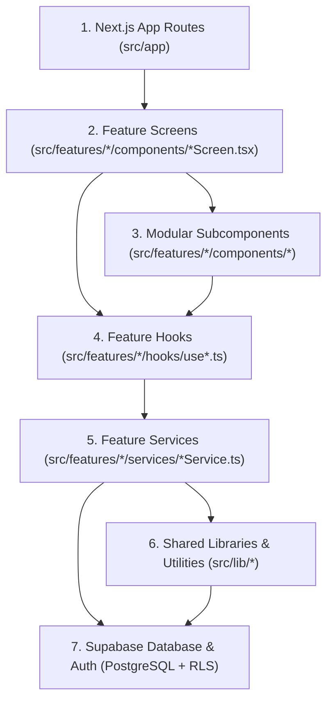
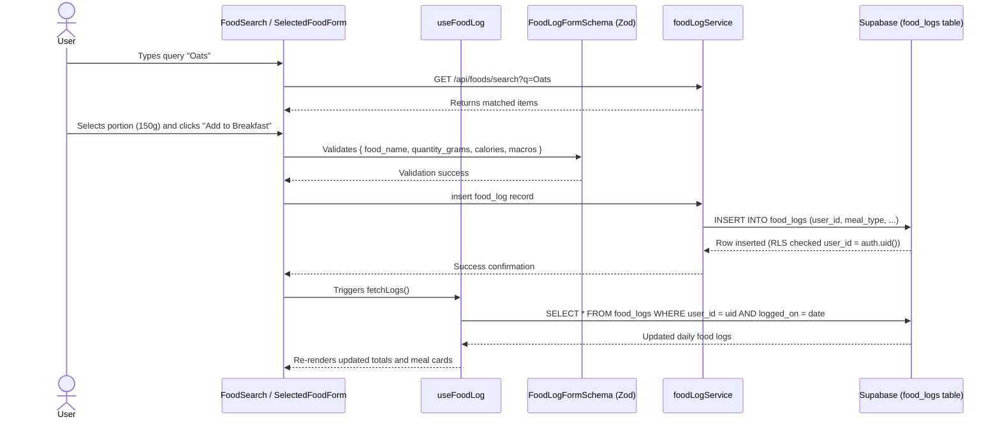

# Architecture & Code Structure Guide

This document provides a comprehensive structural guide for teachers and evaluators reviewing the codebase. It details the directory tree, layer responsibilities, data flow patterns, and architectural boundaries.

---

## 1. Directory Tree (`src/` depth 3)

```text
src/
+-- app/
  +-- (app)/
    +-- burn-calculator/
    +-- dashboard/
    +-- foods/
    +-- history/
    |-- layout.tsx
    +-- log/
    +-- onboarding/
    +-- profile/
  +-- (auth)/
    |-- layout.tsx
    +-- login/
    +-- signup/
  +-- api/
    +-- foods/
  |-- error.tsx
  |-- favicon.ico
  |-- globals.css
  |-- layout.tsx
  |-- not-found.tsx
  |-- page.tsx
+-- components/
  +-- layout/
    |-- index.ts
    |-- NavSidebar.tsx
  +-- ui/
    |-- Button.tsx
    |-- Card.tsx
    |-- Input.tsx
+-- features/
  +-- auth/
    +-- components/
    +-- hooks/
    +-- services/
    |-- index.ts
    |-- types.ts
  +-- burn-calculator/
    +-- components/
    +-- hooks/
    +-- services/
    |-- index.ts
    |-- types.ts
  +-- custom-foods/
    +-- components/
    +-- hooks/
    +-- services/
    |-- index.ts
    |-- types.ts
  +-- dashboard/
    +-- components/
    +-- services/
    |-- index.ts
    |-- types.ts
  +-- exercise-log/
    +-- components/
    +-- hooks/
    +-- services/
    |-- index.ts
    |-- types.ts
  +-- food-log/
    +-- components/
    +-- hooks/
    +-- services/
    |-- index.ts
    |-- types.ts
  +-- history/
    +-- components/
    +-- hooks/
    +-- services/
    |-- index.ts
    |-- types.ts
  +-- onboarding/
    +-- components/
    +-- hooks/
    +-- services/
    |-- index.ts
    |-- types.ts
  +-- profile/
    +-- components/
    +-- hooks/
    +-- services/
    |-- index.ts
    |-- types.ts
+-- lib/
  +-- auth/
    |-- routes.ts
    +-- __tests__/
  +-- calc/
    |-- bmr.ts
    |-- burn.ts
    |-- macros.ts
    +-- __tests__/
  +-- csv/
    |-- index.ts
    +-- __tests__/
  +-- dates/
    |-- index.ts
    +-- __tests__/
  +-- errors/
    |-- index.ts
    +-- __tests__/
  +-- supabase/
    |-- client.ts
    |-- middleware.ts
    |-- server.ts
  +-- ui/
    |-- index.ts
  +-- validation/
    |-- schemas.ts
    +-- __tests__/
+-- types/
  |-- database.ts
+-- __tests__/
  |-- architecture.test.ts
|-- middleware.ts
```

---

## 2. Architectural Layers

The codebase is organized into strict unidirectional layers:



1. **App Routes (`src/app/`)**: Thin Next.js 15 route wrappers (4-24 lines each). Responsible solely for Next.js file-system routing, Server Component data fetching delegation, and rendering feature screens. No inline queries, no direct mutation handlers, no giant state blocks.
2. **Feature Screens (`src/features/<feature>/components/<Screen>.tsx`)**: Top-level page view orchestrators. Composes domain subcomponents, binds state hooks, and sets page layouts.
3. **Modular Subcomponents (`src/features/<feature>/components/`)**: Self-contained UI components (e.g., `MealSection`, `FoodLogDateBar`, `ExerciseForm`, `WeighInCard`). Every subcomponent is under 250 lines and focused on a single responsibility.
4. **Feature Hooks (`src/features/<feature>/hooks/use<Feature>.ts`)**: Encapsulates React state, side-effects, event callbacks, live calculations, and form lifecycle.
5. **Feature Services (`src/features/<feature>/services/<feature>Service.ts`)**: Pure TypeScript functions executing Supabase PostgREST queries, remote API calls (e.g. Open Food Facts), and mutations. Contains no React JSX or hooks.
6. **Shared Libraries (`src/lib/`)**: Modular, domain-agnostic calculation engines and system tools:
   - `lib/calc`: Mifflin-St Jeor BMR, TDEE, macro formulas, Compendium of Physical Activities MET calculations.
   - `lib/dates`: Local calendar date formatting and offsets across UTC boundaries.
   - `lib/errors`: Database and Supabase error sanitization (preventing schema leaks).
   - `lib/csv`: Neutralized, formula-safe CSV generator with deterministic pagination.
   - `lib/auth`: Safe redirect URL validator rejecting open redirect payloads.
   - `lib/validation`: Strict Zod schemas enforcing physical bounds.
7. **Supabase Database**: PostgreSQL backend enforced by Row Level Security (RLS) policies on all tables (`profiles`, `foods`, `food_logs`, `exercises`, `exercise_logs`, `weight_logs`, `burn_plans`).

---

## 3. Public API Boundaries & Architecture Enforcement

Cross-feature boundary integrity is strictly maintained and automated by unit testing:
- **Rule**: No file outside a feature may import internal paths (`@/features/<feature>/components/...`, `hooks/...`, `services/...`).
- **Access**: External consumers MUST import exclusively from `@/features/<feature>`.
- **Enforcement**: Automated in `src/__tests__/architecture.test.ts`. Any attempt to import internal paths directly breaks CI.

---

## 4. End-to-End Data Flow (Example: Logging a Food)


